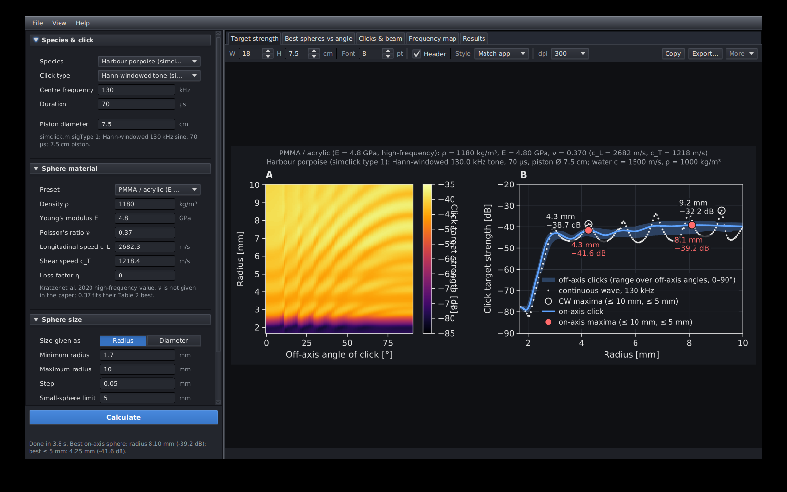

# Sphere TS (JavaFX)

A desktop app that estimates the echo **target strength (TS) of small solid spheres** (PMMA, polycarbonate,
metals or any material you define) for **porpoise, dolphin and other odontocete echolocation clicks**, on and off
the beam axis. It is a port of the Python scripts in [`../python`](../python) and gives the same numbers (see *Validation*).

* Exact elastic-sphere scattering solution (Faran 1951; Hickling 1962), the physics Kratzer et al. (2020,
  *Front. Mar. Sci.* 7:539) solved with COMSOL.
* Clicks and beams from `simclick.m` / `pistonimpulse.m`: the animal is a circular piston, so a click from
  off-axis angle θ is the on-axis click filtered by D(f, θ) = 2·J1(ka·sinθ)/(ka·sinθ).
* Click TS = echo energy / incident click energy, for every sphere size and angle.

## Run it

Needs a JDK 17 or newer (21 recommended) and Maven 3.8+.

    mvn javafx:run

or build and run the tests (they compare against the Python results):

    mvn package

## Using the app

Left panel (hover over any label or field for an explanation):

| Section | What you set |
|---|---|
| **Species & click** | Preset: harbour porpoise, dolphin and beluga clicks from `simclick.m`, a Gaussian NBHF porpoise click, and the 13 species of Kratzer et al. 2020 Table 2 (centre frequency from the paper; click shape and piston size are generic, so edit them if you have measurements). Click type (Hann-windowed tone, single cycle, Gaussian, or your own **.wav** file), centre frequency, duration / bandwidth, piston diameter. |
| **Sphere material** | Preset (PMMA high-frequency/static/ultrasonic, polycarbonate static/ultrasonic, tungsten carbide, copper, steel, aluminium), then edit any of density, Young's modulus, Poisson's ratio, longitudinal and shear sound speed (E/ν and the speeds stay in sync), and loss factor. |
| **Sphere size** | Minimum / maximum **radius** (or switch to diameter), step, and a "small sphere" limit for the second maximum. |
| **Water** | Sound speed and density, or calculate them from temperature, salinity and depth. |
| **Analysis** | Off-axis angle range, what the off-axis band shows (full range, 10–90 %, 25–75 %), continuous-wave frequency, frequency range and resolution. |

Press **Calculate** (Ctrl/⌘+Enter). Tabs on the right:

* **Target strength**: (A) inferno heatmap of click TS by size and off-axis angle; (B) TS vs size for the on-axis click
  with the off-axis band, the continuous-wave TS (dots) and the maxima.
* **Best spheres vs angle**: TS of the best overall and best small sphere against angle.
* **Clicks & beam**: click waveform and spectrum at 0, 5, 10, 20, 45, 90°, and the energy beam profile.
* **Frequency map**: continuous-wave TS by size and frequency.
* **Results**: text summary; save the numbers as CSV (same layout as the Python scripts).

### Figures

Each figure is drawn exactly as it will be exported (WYSIWYG), scaled to fit the window. In the figure toolbar set
the **width and height in cm** and **font size in pt** for your journal, show or hide the parameter header, and pick
the **style: light, dark or match the app**. Then:

* **Copy**: puts the figure on the clipboard as an image at the chosen dpi (300 by default). *More → Copy light
  version* copies a white-background version while you work in dark mode; *Copy as SVG text* copies vector code.
* **Export…**: PNG (with the dpi stored in the file, so Word/LaTeX size it correctly) or SVG (vector; convert to
  PDF/EPS with Inkscape if a journal needs it).
* Right-click a figure for the same options; hover over a plot to read off values.
* *File → Export all figures…* saves all four as 300-dpi PNG + SVG.

*View → Dark mode* (Ctrl/⌘+Shift+D) switches the app between dark (default) and light; the choice is remembered.

## Installers (jpackage)

The `installer` profile builds a self-contained installer that includes a trimmed Java runtime, so users do not need
Java. Build on the platform you are targeting (jpackage cannot cross-build):

    mvn -Pinstaller package

| Platform | Output | Notes |
|---|---|---|
| macOS (Apple silicon or Intel) | `target/installer/SphereTS-1.0.0.dmg` | Unsigned: first launch with right-click → Open, or sign with `--mac-sign` options. |
| Windows | `target/installer/SphereTS-1.0.0.msi` | Needs the [WiX Toolset 3.x](https://github.com/wixtoolset/wix3/releases) on the PATH (JDK 24+ also accepts WiX 4/5). Installs per user, with Start-menu entry and desktop shortcut. |
| Linux | `target/installer/SphereTS/` app image | Use `-Djpackage.type=deb` or `rpm` for a package. |

Change the package type with `-Djpackage.type=exe` (Windows), `pkg` (macOS) or `app-image` (any). The OS profiles
(`platform-windows`, `platform-mac-x64`, `platform-mac-aarch64`, `platform-linux`) are activated automatically and pick the
matching JavaFX natives. Icons are in `src/main/packaging/`.

No Windows machine? The GitHub Actions workflow in `../.github/workflows/installers.yml` (repository root) builds the Windows, macOS (Apple
silicon) and macOS (Intel) installers on GitHub's runners when you push a tag such as `v1.0.0` or run it manually.

## Validation

`mvn test` runs `src/test/java/spherets/model/ValidationTest.java`:

* Java vs the Python `sphere_ts.py` outputs (PMMA and polycarbonate; porpoise, dolphin and `fakeporp4J2.wav` clicks; full
  167 × 91 diameter × angle grid; lossy material with a Gaussian click): max difference **0.0001 dB**.
* 38.1 mm tungsten carbide sphere at 38 kHz: −42.39 dB (accepted −42.4 dB).
* Kratzer et al. 2020 Table 2: optimal diameters within 0.3 mm, TS 0.41 dB rms.

## Code layout

    src/main/java/spherets/model   physics: SphereModel (Faran/Hickling), Click, Species, Material(s), Water, Results
    src/main/java/spherets/plot    plotting: Figure, XYPanel, HeatmapPanel, Gfx (JavaFX canvas + SVG back ends), FigureView
    src/main/java/spherets/ui      JavaFX app: SphereTsApp, Figures, NumberField
    src/main/resources             app.css (dark/light themes), icon

## Assumptions

Solid, homogeneous, isotropic sphere in the free field (no holes, cuts or net attachment); far-field backscatter;
lossless unless a loss factor is set. Plastics' high-frequency (dynamic) stiffness is higher than datasheet values,
and the TS peaks move with it, so measure the sound speeds of your actual stock if you can. The polycarbonate presets
have not been checked against tank measurements.
